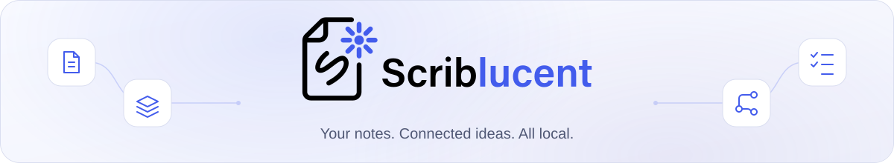
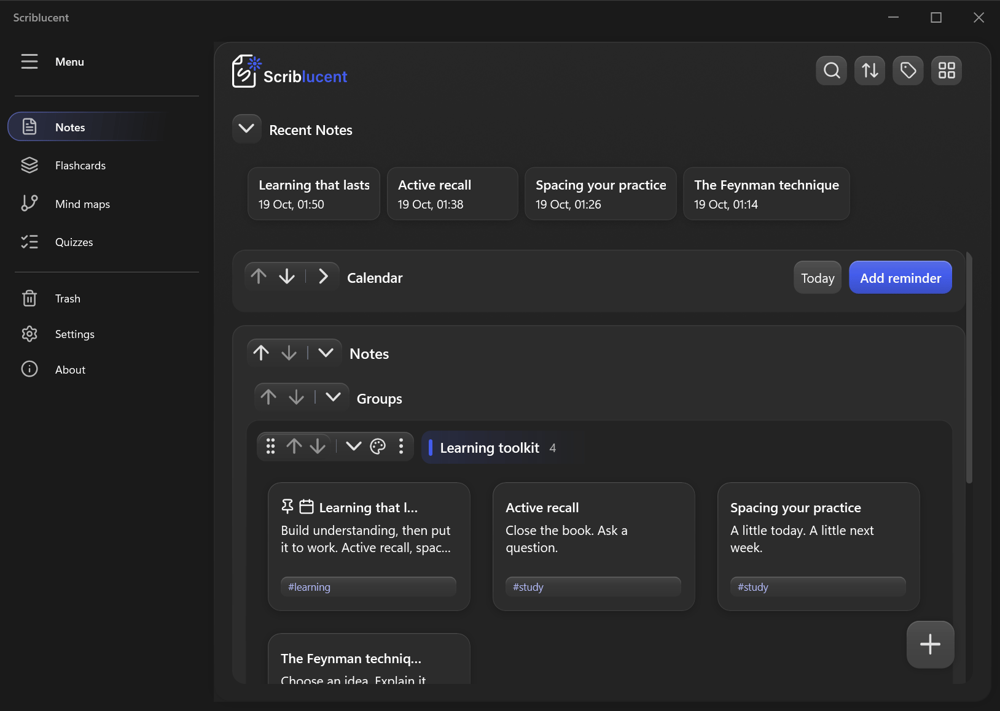
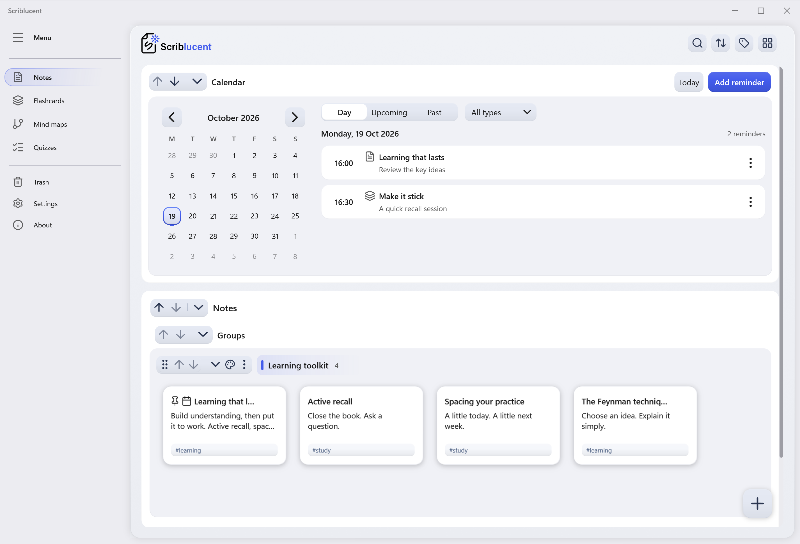
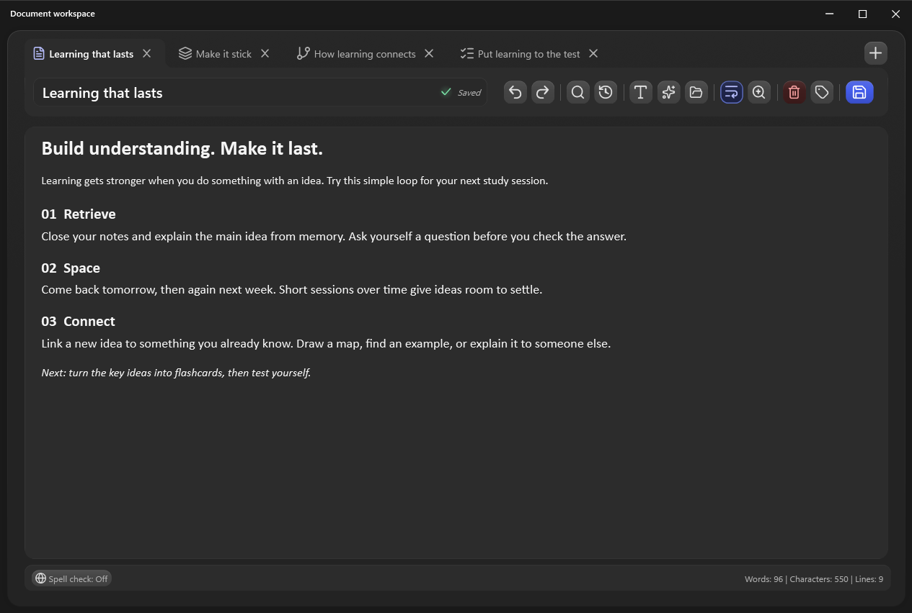
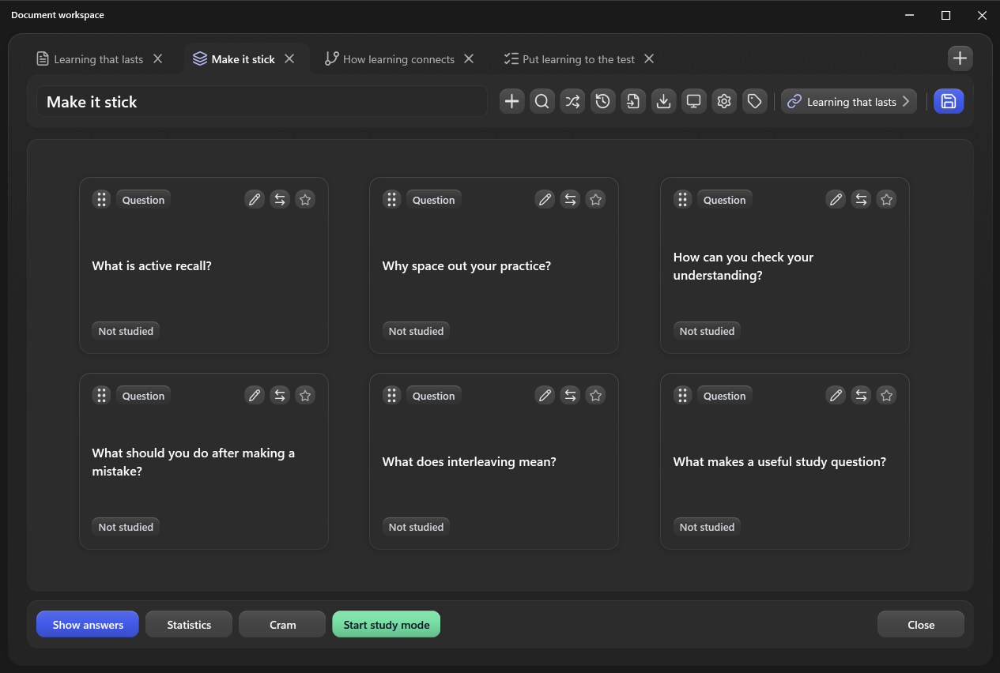
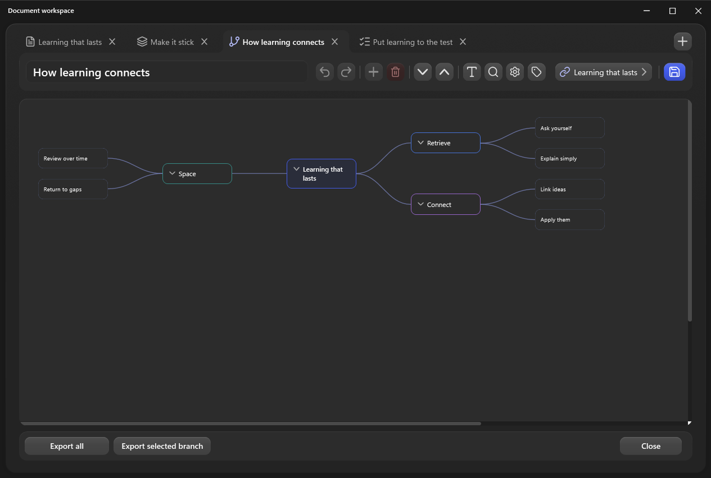
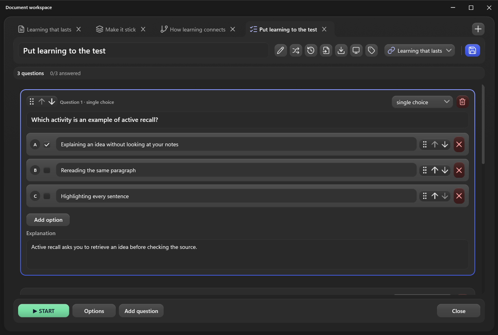

<div align="center">

<picture>
  <source media="(max-width: 600px) and (prefers-color-scheme: dark)" srcset="Scriblucent/Assets/brand-logo-light.svg">
  <source media="(max-width: 600px)" srcset="Scriblucent/Assets/brand-logo-dark.svg">
  <source media="(prefers-color-scheme: dark)" srcset="Screenshots/readme-cover-dark.svg">
  <source media="(prefers-color-scheme: light)" srcset="Screenshots/readme-cover-light.svg">
  
</picture>

# Write. Recite. Get it right.

Learn offline at your own pace. Take notes, build flashcards, map ideas, and test yourself, all in one private space.

**[Download for Windows](https://github.com/ncyxie/Scriblucent/releases)** &nbsp; · &nbsp; [Explore the tools](#one-place-to-think-and-learn) &nbsp; · &nbsp; [Get started](#get-started)

Windows 10 &amp; 11 · x64 &amp; ARM64 · Free and open source

<a href="Screenshots/scriblucent-in-motion.gif"></a>

<sub>A workspace that feels alive. Cursor-responsive cards, a gliding sidebar, and quick actions.</sub>

</div>

<details>
<summary><strong>Explore the dashboard in light and dark mode</strong></summary>

<picture>
  <source media="(prefers-color-scheme: dark)" srcset="Screenshots/dashboard-dark.png">
  <source media="(prefers-color-scheme: light)" srcset="Screenshots/dashboard-light.png">
  
</picture>

[Light dashboard](Screenshots/dashboard-light.png) · [Dark dashboard](Screenshots/dashboard-dark.png)

</details>

## One place to think and learn

Start with an idea. Keep your notes and study materials together, then move between them in a shared tabbed workspace. Click an editor to explore it at full resolution.

<table>
  <tbody>
    <tr>
      <td width="50%" valign="top">
        <a href="Screenshots/editor-note.png"></a>
        <h3>Notes</h3>
        <p>Rich text, images, templates, and linked notes. Includes autosave and version history.</p>
      </td>
      <td width="50%" valign="top">
        <a href="Screenshots/editor-flashcards.png"></a>
        <h3>Flashcards</h3>
        <p>Text, images, and audio for active recall. Study with spaced repetition and track progress.</p>
      </td>
    </tr>
  </tbody>
  <tbody>
    <tr>
      <td width="50%" valign="top">
        <a href="Screenshots/editor-mindmap.png"></a>
        <h3>Mind maps</h3>
        <p>Connect ideas, arrange branches, and style nodes. Link maps back to the notes behind them.</p>
      </td>
      <td width="50%" valign="top">
        <a href="Screenshots/editor-quiz.png"></a>
        <h3>Quizzes</h3>
        <p>Choice, true/false, and written questions. Review attempts and learn from missed answers.</p>
      </td>
    </tr>
  </tbody>
</table>

## Keep your next step in sight

- **Find your flow.** Organize materials with groups and tags, search your collection, drag items into your own order, and handle selections in bulk.
- **Make room for practice.** Schedule reminders right from your materials and see what is coming up in the dashboard calendar.
- **Make it yours.** Switch between light and dark themes, choose English or Lithuanian, and adjust motion to your preference.
- **Take your materials with you.** Import and export notes and study materials for sharing, backups, or moving to another computer. Export selected dashboard items together in a ZIP archive.

## Your materials, on your computer

Notes, study materials, and settings are stored locally. Write, organize, and study offline. Your materials stay on your device.

When you want a starting point, **optional local AI** can generate flashcards, mind maps, and quizzes from your notes. Choose a model suited to your computer; it downloads when needed and runs locally afterward. Review generated material before studying it.

An internet connection is needed to download models, spell-check dictionaries, and app updates. Automatic update checks can be turned off in Settings. Writing, organizing, and studying work offline, and AI is never required.

## Get started

**Windows 10 (1809+) or Windows 11 · x64 / ARM64**. See Microsoft's [supported Windows editions](https://learn.microsoft.com/en-us/dotnet/core/install/windows#supported-versions) for runtime compatibility.

1. Download the Windows setup installer from [Releases](https://github.com/ncyxie/Scriblucent/releases).
2. Choose **x64** for most Windows PCs or **ARM64** for Windows on Arm, then run the installer. The required runtimes are included.
3. Open Scriblucent and create your first note or study set using the **+** button, or import existing materials.

Installers are currently unsigned and require administrator approval. Uninstalling keeps your local data.

Scriblucent is currently in beta. If something gets in your way, [report an issue](https://github.com/ncyxie/Scriblucent/issues) with the steps to reproduce it.

<details>
<summary><strong>Build from source</strong></summary>

On Windows, install the [.NET 10 SDK](https://dotnet.microsoft.com/en-us/download/dotnet/10.0), then run from the repository root:

```powershell
dotnet restore Scriblucent/Scriblucent.csproj
dotnet run --project Scriblucent -c Release
```

</details>

---

[Download beta](https://github.com/ncyxie/Scriblucent/releases) · [Report an issue](https://github.com/ncyxie/Scriblucent/issues) · [Changelog](CHANGELOG.md) · [MIT License](LICENSE) · [Third-party notices](THIRD-PARTY-NOTICES.md)
